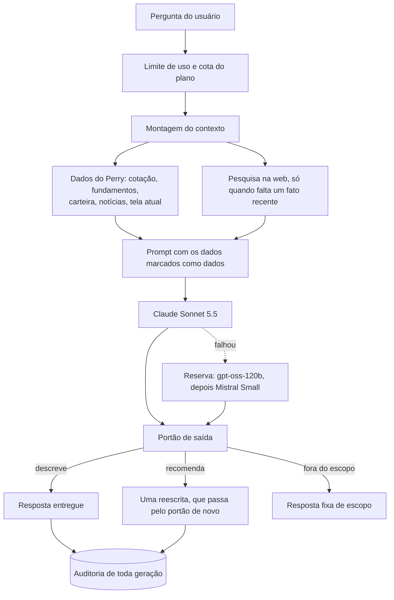

# Perry: como fiz um LLM de finanças parar de inventar números

O [Perry](https://perryinveste.com) é uma plataforma de educação financeira e acompanhamento de investimentos para quem está começando, que eu fundei e desenvolvo. Dentro dele existe o "Pergunte ao Perry", um assistente que responde sobre ações, sobre a carteira do usuário e sobre o que está acontecendo no mercado.

Este texto conta como a IA desse assistente ficou confiável. O código do Perry é privado, então aqui não há código: há as decisões, os números medidos antes e depois de cada uma e o que deu errado no caminho.

## O risco

Num assistente de investimentos, duas coisas não podem acontecer.

A primeira é inventar número. Quem está começando não tem como perceber que o dividendo citado está errado ou que a ação "não subiu" quando subiu 55%. Acredita, e decide com base nisso.

A segunda é recomendar investimento. Pelas regras da CVM, consultoria e análise de valores mobiliários são atividades reguladas. O Perry explica e ensina; quem decide é a pessoa. A IA precisa respeitar essa linha mesmo quando o usuário pede, com todas as letras, "o que eu compro?".

Os dois problemas têm a mesma raiz: um LLM sozinho responde com o que acha que sabe. A solução foi não deixar o modelo sozinho em nenhum momento, com três camadas: os dados do próprio Perry, uma pesquisa na web com regras rígidas e um portão que confere toda resposta antes de ela chegar ao usuário.

## Como uma pergunta vira resposta

## Camada 1: os dados do próprio Perry

Até agosto, o modelo recebia só a pergunta. "Qual o DY da PETR4?" voltava com uma resposta genérica ou com um número inventado.

Hoje, antes de chamar o modelo, o servidor descobre de quais ativos e de que assunto a pergunta trata e busca os dados nas mesmas funções e nos mesmos caches que alimentam as páginas do site. O critério de aceite foi simples: o chat tem que dizer o mesmo dividend yield que a página da ação mostra.

O bloco de dados não traz só números. Traz a data, o atraso da cotação e o que o site não tem, com frases como "sem balanço trimestre a trimestre" e uma linha que lista os dados ausentes. Quando o modelo sabe o que falta, ele diz que falta em vez de completar de cabeça.

Quatro decisões dessa camada vieram de erros reais:

- **Conta é com o servidor, nunca com o modelo.** Um filtro esperava um campo de data com um nome, e a produção mandava com outro. O bloco de desempenho saía vazio em toda pergunta, e o chat respondeu que a AZZA3 "não subiu" num mês em que ela subiu 55%. Hoje a variação vem calculada, e um teste pega esse tipo de quebra.
- **"Hoje" se mede pelo fechamento, não pelo intradiário.** Com barras de minuto, o chat disse que o ITUB4 "não caiu hoje" (+0,32%) quando ele caía 1,57%.
- **O veredito também vem pronto.** Com os dois números na mão, a variação do papel e a do Ibovespa, o modelo às vezes invertia a conclusão. Agora o site calcula quem foi melhor e entrega a frase.
- **Carteira e ativo nunca entram no mesmo prompt.** Juntar "a sua carteira" com "a PETR4" é o caminho mais curto para uma recomendação personalizada. Se a pergunta é sobre a carteira, a carteira vence.

Cada fonte tem 2,5 segundos para responder, e o contexto inteiro tem 8. Uma fonte atrasada vira um bloco a menos, não um erro.

## Camada 2: pesquisa na web com rédea curta

Em outubro, alguém perguntou "o que aconteceu que as ações subiram muito?" e o Perry respondeu que não havia notícias. O acervo de manchetes cobria só de 1 a 3 dias, e o motivo da alta era a eleição.

A pesquisa na web resolveu isso, com regras que impedem que ela vire uma porta de entrada para erro:

- A consulta é montada pelo servidor a partir do ativo, da marca ou do tema, nunca a partir do texto do usuário.
- Só valem uma lista fechada de veículos de imprensa e as fontes oficiais (B3, CVM, Banco Central, IBGE). O domínio é conferido duas vezes: na chamada e depois em cada resultado.
- Resultado sem data ou velho demais é descartado. Título com cara de recomendação, como lista de "ações para comprar" ou preço-alvo, nem chega ao prompt.
- O resultado fica 30 minutos em cache, e cada busca custa cerca de US$ 0,01.

A parte mais difícil foi a causalidade. O modelo adora ligar a notícia do dia ao movimento da ação, mesmo quando a notícia não fala disso. A regra final é que uma manchete só vira motivo se ela mesma liga o fato ao movimento, e a frase precisa começar com "Segundo o <veículo>, <data>". Nas sondas, que são lotes de perguntas fixas repetidas antes e depois de cada mudança:

- causa falsa: de 4 em 6 respostas para 0 em 8;
- o modelo emendando uma conclusão própria depois da fonte: de 13 em 16 para 0 em 16;
- perguntas de controle, em que a manchete não explica o movimento: 0 causas falsas em 20.

Com a busca ligada, a eleição passou a aparecer como motivo da alta em 15 de 15 respostas (antes, 0 de 15). As perguntas sobre a última decisão do Copom acertaram o corte da Selic em 6 de 6.

Mais um detalhe que parece bobo e não é: a data de hoje vai no prompt. Sem ela, o modelo, treinado antes desses fatos, tratava notícias de 2026 como "hipóteses" ou tentava "corrigi-las".

Desde outubro, o chat de quem está logado também pode pesquisar por conta própria, com até duas buscas, só para fatos recentes que faltam nos dados. Aqui há uma troca consciente: o texto das páginas entra sem o filtro de títulos, e quem protege a resposta é só a camada 3.

## Camada 3: toda resposta passa por um portão

Nenhuma geração chega ao usuário sem passar por estas etapas, nesta ordem:

1. **Limpeza.** Links são removidos. Em produção, o modelo chegou a inventar um link para um site de terceiros; hoje quem decide para onde o usuário vai é o servidor, com um botão de navegação.
2. **Tamanho e repetição.** Resposta gigante ou presa em repetição é descartada sem gastar o juiz.
3. **Contato e phishing.** Telefone, e-mail, pedido de Pix ou de senha descarta a resposta na hora. É a defesa contra uma notícia maliciosa que tente injetar instruções no modelo.
4. **O juiz.** Um segundo modelo, de outra família (Mistral, com temperatura 0), lê a resposta e responde com uma palavra: descreve, recomenda ou fora do escopo. Se o juiz não responder, a resposta não sai.
5. **Uma reescrita.** Se o juiz diz "recomenda", o trecho é reescrito uma vez, sem acrescentar fatos, e volta para o portão inteiro. Na sonda, 18 de 18 reescritas tiraram o trecho problemático sem perder nenhum número.

O juiz existe porque um filtro de palavras sozinho não basta. Numa auditoria interna de agosto, 12 de 14 recomendações explícitas, como "vale a pena olhar para PETR4" ou "rebalanceie para 60/40", passavam pelo filtro.

O filtro também errava para o outro lado. Ele bloqueava vocabulário comum de notícia, como "venda da Farm Rio" ou "melhor trimestre", e já acumulava umas 15 exceções remendadas. Em outubro, troquei a lista de palavras por padrões de forma de conselho (imperativo, primeira pessoa, juízo de preço sobre o investimento, escolha de vencedor) e reapliquei a regra nova sobre 3.056 análises de notícias já geradas: nenhuma passou a ser bloqueada e 446 deixaram de ser marcadas à toa. Li uma por uma.

Se a IA cair de vez e os dados do site já tiverem sido carregados, o Perry responde com os próprios números e uma frase de moldura. Ele nunca preenche o buraco inventando.

## Medir antes de mudar

A lição que mais se repetiu: efeito de prompt se mede, não se deduz.

- **Encurtar pode quebrar tudo.** Limitar cada análise de notícia a 35 palavras, para ficar mais enxuta, fez o descarte do portão pular de cerca de 25% para 100% (6 de 6). Com pouco espaço, o modelo recorria a palavras curtas e proibidas. A mudança foi revertida no mesmo dia.
- **Proibir uma palavra ensina o modelo a usá-la.** O prompt mandava evitar dizer que uma ação estava "cara", e a pergunta sobre P/L morria 2 de 3 vezes justamente por causa dessa palavra. Trocar a proibição por uma forma segura ("acima ou abaixo da mediana do setor") fez a mesma pergunta passar 7 de 7.
- **Repetir não resolve.** Uma nova tentativa idêntica, depois de um descarte, morria de novo em 21 de 26 casos.

Por isso, toda mudança no prompt de sistema exige rodar de novo uma sonda fixa de 14 perguntas, com várias amostras por caso.

## O incidente de produção

No começo de setembro, a observabilidade do Worker mostrou o tamanho do problema em 7 dias: 293 falhas em cerca de 1.070 tentativas de geração, ou 27%. Eram 271 respostas vazias e 22 estouros de tempo, 88% delas no feed de notícias. A reserva no Anthropic, que deveria salvar essas falhas, recusou as 290 chamadas que recebeu com erro 401.

A causa mais provável, que o diagnóstico registra como não provada diretamente, foi a troca do modelo principal para o gpt-oss-120b. Ele é um modelo que raciocina antes de responder, e esse raciocínio sai do mesmo limite de tokens da resposta. Os limites tinham sido dimensionados para um modelo que não raciocinava, então o raciocínio consumia tudo e sobrava uma resposta vazia.

O mesmo diagnóstico achou um segundo defeito: o visitante sem conta pagava cota até quando a geração falhava. Quatro perguntas de teste consumiram 4 das 5 perguntas do mês.

As correções saíram juntas:

- **Limite com folga de raciocínio.** O teto passou a ser o tamanho da resposta mais uma folga para o raciocínio. O teste escreve a conta como soma, para que quem diminuir a folga sem querer quebre o teste.
- **Cota devolvida quando a falha é do Perry.** A cota volta quando a falha é do sistema, nunca quando o texto foi reprovado pelo portão.
- **Disjuntor na reserva.** Erro de autenticação ou de crédito desliga a reserva até o fim daquela instância. Erro 5xx ou estouro de tempo não desliga, porque costuma ser passageiro.

No fim de setembro veio a correção de fundo: saiu o orquestrador intermediário (n8n), que era mais um ponto de falha, e o Worker passou a chamar os modelos diretamente. Hoje a folga do chat é cerca de 1,8 vez o maior raciocínio já medido.

## Custo sob controle

- **Cota por plano, conferida antes da chamada.** No plano gratuito são 15 perguntas por mês, e no Pro, 150. A conferência é fechada a falhas: se o contador der erro, a pessoa recebe a resposta sem IA, nunca IA de graça.
- **Orçamento diário em camadas:** global, por plano e por usuário. Antes de cada chamada, o sistema reserva o custo no pior caso, com o limite máximo de tokens, e depois acerta pelo uso real. Aqui a decisão é a oposta, de propósito: se o banco de dados quebrar, a IA continua ligada, porque um banco quebrado não pode desligar o produto inteiro. O teto total é de alguns dólares por dia.
- **Cache onde não muda o resultado:** dados de ações por 1 hora, pesquisas por 30 minutos, análises de notícias por 24 horas. Respostas do chat não ficam em cache.

## Operação

- **Cadeia de modelos.** O Claude Sonnet 5.5 responde no chat de quem está logado, e o Claude Haiku 5.5 atende os visitantes e os fluxos mais simples. Se o Claude falhar, a reserva é o gpt-oss-120b e depois o Mistral Small, todos dentro de um único prazo compartilhado.
- **A pergunta continua mesmo se o app sair da tela.** Uma pergunta leva de 5 a 35 segundos, e o Android corta a conexão cerca de 6 segundos depois de o app ir para segundo plano. Por isso, o trabalho continua no servidor mesmo que o app feche.
- **Auditoria de toda geração, entregue ou descartada.** Ficam registrados o tipo de fluxo, o veredito, o modelo, o hash do texto e a versão do prompt. O prompt em si nunca é guardado. O log comum do Worker dura poucos dias, e a auditoria precisa responder "o que o Perry publicou sobre tal empresa em agosto?".
- **Denúncia pelo usuário.** O usuário pode reportar uma resposta como incorreta, ofensiva ou como recomendação.
- **Testes.** Mais de 600 testes cobrem a IA. Um deles nasceu de uma auditoria de segurança: uma expressão regular do portão tinha custo cúbico, e um texto com 3.200 espaços levava 7,5 segundos para ser avaliado, o bastante para derrubar uma invocação inteira do Worker. Hoje toda expressão regular nova entra num teste que exige menos de 1 segundo em entradas hostis de 100 kB.

## O que eu levo disso

- **A assertividade vem do que o modelo recebe, não do tamanho do modelo.** Os maiores ganhos vieram de dar ao modelo os dados certos e dizer o que faltava, não de trocar de modelo.
- **O modelo não faz conta, não escolhe link e não decide sozinho o que é recomendação.** Tudo o que dá para fazer de forma determinística fica com o servidor.
- **Errar precisa sair barato.** Isso vale para o usuário, com a cota devolvida, e para o produto, que responde com os dados do site quando a IA cai.
- **Toda mudança de prompt é um experimento.** Ela tem sonda antes, sonda depois e número no registro.

---

Fernando Mendonça · [LinkedIn](https://www.linkedin.com/in/fernando-mendonca26/) · [GitHub](https://github.com/fernandomcrsilva) · [perryinveste.com](https://perryinveste.com)
